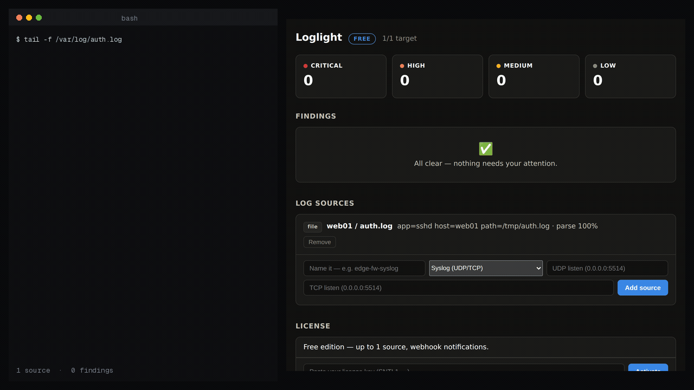

# Loglight

**Self-hosted threat detection from your logs and network flows — brute force, scans, exfiltration, beaconing, and correlated kill-chains, with a 3D map of your network.**



*Real run: a port sweep, then failed logins, then one that works — all from the same address, 30
seconds end to end. Three separate detections become one CRITICAL incident with the kill chain
attached, instead of three alerts you have to correlate yourself.*

You have logs. `auth.log`, your firewall's syslog, a few Windows boxes, some
containers. Nobody reads them — so if you're being brute-forced or something is
beaconing out, you find out a week too late. A full SIEM (Splunk, Elastic) is a
project you don't have time for. Loglight is the **SIEM-lite** for that gap.

Point your logs at it and Loglight runs curated, high-signal detections and shows
a short, ranked list of *what looks like an attack*:

- **Brute force / credential stuffing** — failed-login bursts per IP, or distributed across many.
- **Port & host scans** — one source touching many distinct ports fast.
- **Abnormal egress** — outbound volume far above a host's baseline (possible exfiltration).
- **New privileged accounts** — `useradd`, sudoers/group changes, Windows 4720/4728 — the classic persistence step.
- **Beaconing** *(v0.2, from flows)* — an internal host calling one external endpoint at a metronome-regular interval: the C2 heartbeat.
- **New services** *(v0.2, from flows)* — a host starts accepting connections on a port never seen for it before.

> The SIEM part: it **correlates**. A scan, then a brute force, then a successful
> login from the same source isn't three blips — it's one **CRITICAL kill-chain
> incident**, escalated above its parts, with the full timeline.

Every finding shows the numbers behind it and the fix — it ranks and explains, it
doesn't hand you a black box. Under the hood: bounded-state streaming detectors +
a per-actor correlation state machine — turning an unbounded log firehose into a
small, explained, ranked set of incidents without a query language.

See the actual output: [`docs/samples/`](docs/samples/) — this exact scan-then-brute-force-then-success scenario, run for real on a lab instance, findings exported exactly as the API returned them.

## Ingest sources

syslog (UDP/TCP, RFC3164 & RFC5424), tailed files (rotation-safe), systemd
journald, Docker containers, Windows Event Log (via a syslog forwarder), and —
new in v0.2 — **NetFlow v5 / v9 / IPFIX** flow export from the router or
firewall you already own (MikroTik, pfSense, FortiGate, Cisco, Ubiquiti). All
normalize to one event model, so every detector works across every source.

## 3D Network Map (v0.2)

Feed Loglight a NetFlow/IPFIX source and it draws your network as a live,
rotatable **3D map** — every host a node sized by traffic, every conversation a
link, and any host with an active detection glowing by severity. Rendered fully
offline with a vendored WebGL engine: no CDN, no external requests, true to the
self-hosted promise. External endpoints auto-group per /24 when the internet
side gets busy, so the picture stays readable. Flow records are **metadata
only** (who talked to whom, which port, how many bytes) — never packet
contents.

## Self-hosted by design

Runs as a single binary or container on your infrastructure. **Your logs never
leave the machine** — no telemetry, no shipping to us, only the alert channels you
configure reach out. Offline license validation — no phone-home, ever. Safe to
run on an isolated management host.

## Quick start

```bash
# Docker — build the image from this repo first; there is no published loglight image
# (map any syslog listener ports you configure)
docker build -t loglight .
docker run -d -p 127.0.0.1:8427:8427 -p 5514:5514/udp -v loglight-data:/data loglight

# Or the bare binary
./loglight
```

Open `http://127.0.0.1:8427`, add a log source (start with a syslog listener or
tail `/var/log/auth.log`), point your hosts at it, and watch the findings — worst
first. For the 3D map, add a **NetFlow / IPFIX** source (e.g. UDP `0.0.0.0:2055`),
point your router's flow export at it, and open **Network Map** in the header.

## Free vs paid

This repository is the **free edition**: **1 source**, all seven detections,
webhook notifications, 3-day retention, self-hosted, no telemetry. It runs the
same detection engine as the paid edition.

The paid edition ([Loglight on Whop](https://whop.com/nizar-tuanku/loglight?utm_source=github)) lifts the caps
and adds the correlation layer and team features:

| | Free | Pro | Team |
|---|---|---|---|
| Sources | 1 | 10 | unlimited |
| Detections (brute, scan, exfil, new-admin, spike, beaconing, new-service) | ✓ | ✓ | ✓ |
| Kill-chain correlation | ✓ — full chain needs ≥2 sources | ✓ | ✓ |
| Custom thresholds · scan-now | — | ✓ | ✓ |
| Notifications | webhook, syslog | + email/Slack/Telegram | + PagerDuty/MS Teams |
| SIEM export (Wazuh, Splunk HEC, syslog JSON/CEF, NDJSON file) | ✓ | ✓ | ✓ |
| Retention | 3 days | 30 days | unlimited (disk-bound) |
| Multi-user | — | — | ✓ |
| Support | community | email | priority |

**Whop sells paid licences only.** Free: github.com/nizartuanku/loglight — this repository is the free edition, Apache-2.0, no time limit; nothing on Whop is free, so try it here first.

Licensing is offline: an expired or absent key simply returns to free limits.

## Build from source

```bash
git clone https://github.com/nizartuanku/loglight
cd loglight
CGO_ENABLED=1 go build -o loglight ./cmd/loglight
go test ./...
```

Requires Go 1.24+. CGO is on for the SQLite driver.

## Working with the other Hexward tools

Loglight is the collector end of the line. Every other Hexward tool can emit
its findings as syslog, so point them here:

```bash
decoy      -syslog loglight.internal:5514        # udp by default
certlight  -syslog loglight.internal:5514 -syslog-network tcp
```

then add a matching source in Loglight:

```bash
curl -X POST localhost:8427/api/loglight/source \
  -H 'Content-Type: application/json' \
  -d '{"name":"hexward-bus","type":"syslog","params":{"udp":"0.0.0.0:5514"}}'
```

Their findings then sit next to Loglight's own detections, and high or critical
ones carrying a source address join that actor's timeline. A Decoy trip from an
address Loglight already saw port-scanning is raised as one critical incident
with the whole chain attached, rather than two alerts you have to join up
yourself.

A finding on its own stays quiet: the tool that raised it already alerted, and
repeating it here would be the duplicate-alert problem this exists to remove.
Findings with no attacker — an expiring certificate, a shadowed firewall rule —
are ignored for correlation and belong on their own product's dashboard.

Loglight can emit its own incidents the same way, so it can forward to a
collector upstream. There is nothing Hexward-specific about the format: any
syslog receiver reads it.

Available on every tier, free included.

## Send findings to your SIEM (Wazuh, Splunk, Elastic)

Every finding Loglight opens or resolves can leave as one
[Hexward Finding Schema](https://github.com/nizartuanku/hexward-core/blob/main/SCHEMA.md)
event (`hexward.finding/1`), the same shape every Hexward tool emits. Write a
SIEM rule once and it covers the whole line. **Available in every edition,
Free included.**

```bash
# NDJSON file for a Wazuh agent, Splunk Universal Forwarder or Elastic Agent
loglight -export-file /var/log/hexward/loglight.ndjson

# Splunk HTTP Event Collector (token read from a file, never a flag)
loglight -hec-url https://splunk.example:8088 -hec-token-file /etc/hexward/hec.token

# Syslog as HFS JSON or CEF, RFC 5424 by default, over udp, tcp or tls
loglight -syslog wazuh.example:5514 -syslog-format json -syslog-network tcp
loglight -syslog siem.example:6514 -syslog-format cef -syslog-network tls -syslog-ca-file ca.pem

# Webhook with the same events, authenticated with a shared secret
loglight -webhook https://hooks.example/hexward -webhook-format v2 -webhook-secret-file secret.txt
```

Ready-made content: [hexward-wazuh](https://github.com/nizartuanku/hexward-wazuh)
(decoder and rules, tested on Wazuh 4.14.9) and
[TA-hexward](https://github.com/nizartuanku/TA-hexward) (Splunk add-on).

| Flag | Default | Meaning |
|---|---|---|
| `-export-file` | off | Append HFS NDJSON to this file |
| `-hec-url`, `-hec-token-file`, `-hec-index`, `-hec-ca-file` | off | Splunk HEC; sourcetype `hexward:finding` |
| `-syslog-format` | `kv` | `kv` (original key=value line), `json` (HFS) or `cef` |
| `-syslog-network` | `udp` | `udp`, `tcp`, or `tls` (json/cef only; certificates are always verified) |
| `-syslog-rfc` | `5424` | Header for json/cef: `5424` or `3164` |
| `-webhook-format` | `v1` | `v1` (original digest) or `v2` (HFS events) |
| `-webhook-secret-file` | off | Shared secret sent as `X-Hexward-Token` (v1 and v2) |
| `-export-evidence` | `redacted` | `redacted` drops secret-like evidence keys; `none` sends no evidence |

Live export carries changes (`opened`, `resolved`). To load what already
exists, pull a snapshot once:
`curl -s http://127.0.0.1:8427/api/findings/export`.

## AI Assist (optional)

Loglight can explain a finding in plain language with a small language model that runs on
your own hardware. It is off by default. Turn it on by starting a
[hexward-ai](https://github.com/nizartuanku/hexward-ai) sidecar and pointing Loglight at it:

```sh
loglight -ai-assist-url http://127.0.0.1:8435
```

Each finding then gets an **✨ Explain** button. The model writes what the finding means and
what to verify before you act. It also gets a fixed disclaimer.

- **The engine still decides.** The model receives one finding after Loglight has produced it.
  It cannot add, remove, re-score or close a finding. If the sidecar is off, slow or broken,
  the button shows a short note and nothing else changes.
- **What leaves the process.** One finding: its check, title, target, severity, status,
  remediation and a sanitised copy of its evidence. Keys that look like secrets (password,
  token, secret, private, credential, cookie, session, signature and similar) are dropped
  first. Nothing goes to the internet. The sidecar runs where you run it.
- **Editions.** The free edition works with a sidecar on the same host. That is the `lab`
  profile, SmolLM3-3B. Pro and Team can also use one dedicated AI host for several products,
  or your own OpenAI-compatible endpoint, through `-ai-assist-key-file`. The recommended
  profile there is `smb` (Phi-4-mini-instruct). Enterprise uses Qwen3 or your own endpoint.
- **Language.** English is the supported language in this release. `-ai-assist-lang id`
  (Bahasa Indonesia) remains as an unsupported preview. More languages will be added based on
  demand.
- **Honest limit.** Small local models sometimes add general background that is not in the
  evidence. For example, they may name a well-known attack, and that background can be wrong.
  Treat the explanation as a starting point. The finding, its evidence and its fix text remain
  the record, which is why every explanation carries the "verify against raw findings" line.
- **Speed.** On a CPU-only machine an explanation takes about 15–50 seconds, depending on the
  model. Measurements are in hexward-ai's `docs/TIERS.md`.

Environment equivalents: `LOGLIGHT_AI_ASSIST_URL`, `LOGLIGHT_AI_ASSIST_KEY_FILE`,
`LOGLIGHT_AI_ASSIST_LANG`, `LOGLIGHT_AI_ASSIST_NO_THINKING=1`.

## Honest limits

Loglight is a **detection** tool, not a forensics platform or a searchable log
archive — it keeps bounded recent events for context, not a long-term store.
Detections are curated, tuned rules (not ML/UEBA); correlation is time- and
entity-bounded heuristics, and every incident shows its member events so you can
judge. Windows ingest is via a syslog forwarder (not a native agent). Flow
telemetry is sampled/aggregated metadata, not packet capture — egress baselines
need a day or two to settle, and the beacon/new-service learning state is
in-memory, so a restart re-learns (a persisting pattern simply re-opens the same
finding). Your exporter must support NetFlow/IPFIX (most business routers do;
some ISP boxes don't — pfSense or MikroTik in front solves it). It's the
high-signal self-hosted layer for teams that have no SIEM — not a replacement for
a full SOC at scale.

## License

Apache-2.0. See [LICENSE.txt](LICENSE.txt).

Part of the **Hexward** line of self-hosted security tools.
